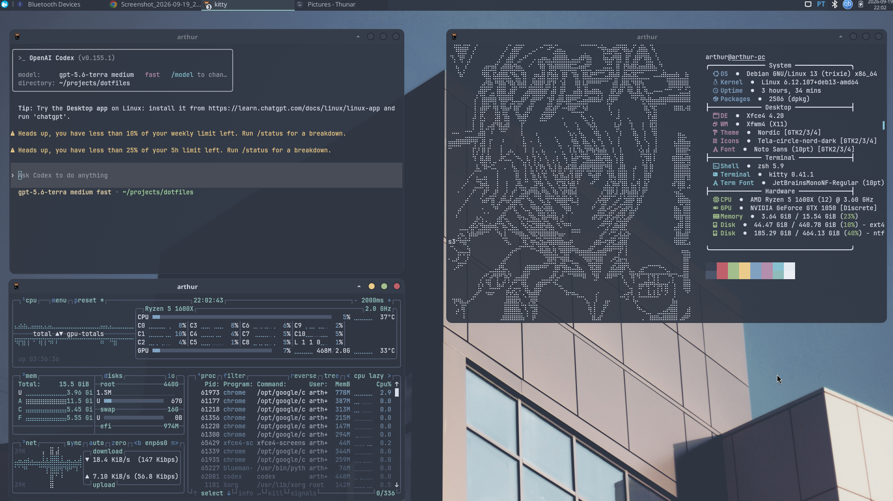

<div align="center">

# dotfiles ⌁

**um pequeno canto do meu terminal, do meu jeito**

`zsh` · `starship` · `nvm` · menos teclas repetidas

<br>

<sub>🪩 ajustado para o trabalho diário &nbsp;·&nbsp; 🐚 propositalmente enxuto</sub>

</div>



---

```text
dotfiles/
├── debian/       guias de configuração do Debian e XFCE
├── fastfetch/    configuração de resumo do sistema e artes de anime
├── fonts/        arquivos das fontes JetBrains Mono
├── git/          configuração global do Git
├── gnome/        configurações de extensões do GNOME
├── mpv/          configuração e atalhos do player de mídia
├── ptyxis/       perfis do terminal
├── redshift/     temperatura de cor e inicialização automática
├── screenshots/  prévias do desktop
├── xfce/         atalhos de teclado e scripts auxiliares
└── zsh/          configuração do shell e dircolors Nord
```

### O que há aqui

- histórico compartilhado do shell, sem duplicatas
- [rice Nord para Debian/XFCE](debian/rice/nord/README.md), incluindo um launcher Rofi
- completion aproximado e sem distinção entre maiúsculas e minúsculas
- inicialização do prompt [Starship](https://starship.rs/)
- autosuggestions e syntax highlighting do Zsh
- inicialização do NVM e alguns aliases de trabalho

### Guias por componente

| Componente | O que cobre |
| --- | --- |
| [Rice Nord](debian/rice/nord/TUTORIAL.md) | configuração de desktop no Debian 13, XFCE e X11 |
| [Blueman](debian/blueman/guia.md) | instalação do gerenciador Bluetooth |
| [MPV](mpv/guia.md) | configuração e atalhos do player |
| [Redshift](redshift/guia.md) | temperatura de cor e inicialização automática |

### Arte do Fastfetch

A [configuração do Fastfetch](fastfetch/config.jsonc) carrega `rei-ayanami-1.txt` por padrão. Instale a configuração e a arte juntas:

```sh
mkdir -p "$HOME/.config/fastfetch"
ln -s "$HOME/dotfiles/fastfetch/config.jsonc" "$HOME/.config/fastfetch/config.jsonc"
ln -s "$HOME/dotfiles/fastfetch/anime" "$HOME/.config/fastfetch/anime"
```

Para usar outro visual, altere `logo.source` em `fastfetch/config.jsonc` para um dos arquivos em [fastfetch/anime](fastfetch/anime/).

### Atalhos do XFCE

O [backup de atalhos do XFCE](xfce/.config/xfce4/xfconf/xfce-perchannel-xml/xfce4-keyboard-shortcuts.xml) inclui `Super+B` para abrir o Chrome e `Super+Q` para fechar a aba atual. O [script de fechar aba](xfce/.local/bin/fechar-aba) envia `Ctrl+Shift+Q` ao Kitty e `Ctrl+W` aos outros aplicativos no X11.

Para restaurar esses dois atalhos a partir da raiz do repositório, em uma sessão XFCE:

```sh
install -Dm755 xfce/.local/bin/fechar-aba ~/.local/bin/fechar-aba
xfconf-query -c xfce4-keyboard-shortcuts -p '/commands/custom/<Super>b' -n -t string -s google-chrome
xfconf-query -c xfce4-keyboard-shortcuts -p '/commands/custom/<Super>q' -n -t string -s "$HOME/.local/bin/fechar-aba"
xfconf-query -c xfce4-keyboard-shortcuts -p '/commands/custom/<Super>c' -r 2>/dev/null || true
```

### Coloque para funcionar

```sh
git clone https://github.com/ArthurBufon/dotfiles.git ~/dotfiles
ln -s ~/dotfiles/zsh/.zshrc ~/.zshrc
mkdir -p "$HOME/.config/dircolors"
ln -s "$HOME/dotfiles/zsh/.config/dircolors/nord" "$HOME/.config/dircolors/nord"
exec zsh
```

> [!NOTE]
> A configuração contém aliases ligados aos caminhos locais dos meus projetos. Leia o arquivo antes de criar o link e ajuste esses caminhos para o seu ambiente.

<details>
<summary><strong>O que o shell espera encontrar</strong></summary>

<br>

- Zsh
- GNU `dircolors`
- [Starship](https://starship.rs/)
- [zoxide](https://github.com/ajeetdsouza/zoxide) (`sudo apt install zoxide` no Debian)
- [`zsh-autosuggestions`](https://github.com/zsh-users/zsh-autosuggestions)
- [`zsh-syntax-highlighting`](https://github.com/zsh-users/zsh-syntax-highlighting)
- NVM, caso o gerenciamento de versões do Node seja necessário

</details>

---

<div align="center">
  <sub>Engrenagens pessoais. Pegue o que servir; deixe o resto. ◌</sub>
</div>
